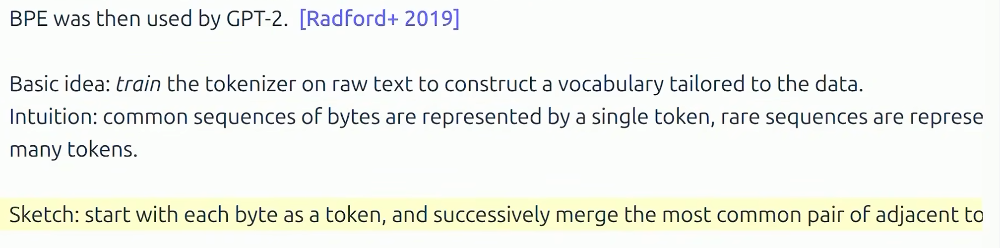

了解一下大模型的训练、推理知识，拥抱AI！
<!--more-->
## 课程链接和参考资料
- [CS336的官方网站](https://cs336.stanford.edu/)

## Overview & Tokenization
> [视频链接](https://www.bilibili.com/video/BV11LEA6eEuj/?spm_id_from=333.788.videopod.sections&vd_source=9f4ada6c3f6b072815db35c0dad8bdd7)

- Tokenizer：encode/decode 从字符串到数值序列（indices）。参考[OpenAI-Tokenizer](https://platform.openai.com/tokenizer)
- LLM的分词器原理BPE：

## Resource Accounting
> [视频链接](https://www.bilibili.com/video/BV11LEA6eEuj/?spm_id_from=333.788.videopod.sections&vd_source=9f4ada6c3f6b072815db35c0dad8bdd7&p=2)
